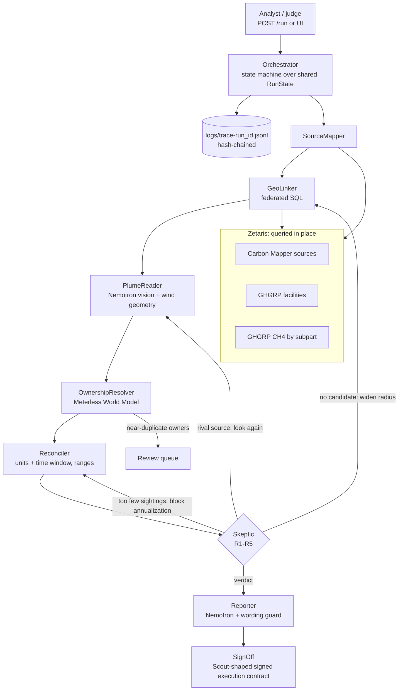

# SkyLedger

**Satellites see the leaks. Companies report the numbers. SkyLedger is an AI agent team that checks one against the other.**

Open Agent Hackathon 2026 · **Track 1: Solving Fragmented Intelligence**

Methane plumes observed from aircraft and satellites (Carbon Mapper: Tanager, EMIT, AVIRIS-NG, GAO), facility self-reports to the US EPA Greenhouse Gas Reporting Program (GHGRP), and corporate ownership records share **no keys, no units and no clocks**. A plume is a point with a rate in kg/h on one morning. A report is a facility ID with CO₂e tonnes for a year. An owner is a free-text string like `TARGA RESOURCES (73%); PIONEER NATURAL RESOURCES USA INC (27%)`. SkyLedger joins them in place through **Zetaris**, resolves owners on the **Meterless World Model**, reads the plume image with **NVIDIA Nemotron** through **Meterless Nightshift**, and makes a **Skeptic** agent rule out five rival explanations before anything is reported. Every finding is a draft until an analyst signs it.

**Who it's for:** ESG and credit analysts, and regulators, who must judge whether a company's reported emissions are plausible. One example is an analyst reviewing California SB 253 Scope 1 disclosures due **Nov 10, 2026**. EPA has delayed RY2025 GHGRP reporting and proposed ending most of the program, which leaves satellite data as one of the few independent checks.

## What a run finds (real output, sample data, 60 Permian plumes)

From `output_examples/example_1.json`:

| Verdict | Plumes | Meaning |
|---|---|---|
| Inconsistent with report | 8 | Even the conservative lower bound of implied annual CH₄ exceeds the facility's RY2023 report |
| No reporter at origin | 32 | No GHGRP point facility within 1 km of the plume head. A nearest-facility match would blame the wrong plant |
| Too few sightings | 9 | Fewer than 2 detections in the reporting-year window, so no annualization |
| Attribution uncertain | 8 | Two plausible sources, or the geometry is inconclusive. Excluded from the roll-up |
| Coverage gap | 3 | The plume falls under basin-level reporting, or the facility doesn't report Subpart W |

Label-free diagnostic from `npm run eval`: nearest-facility matching names a facility **more than 1 km from the plume head in 19 of 60 plumes**. Naive annualization flags **34** discrepancies; SkyLedger flags **8** after the Skeptic. The hand-labelled accuracy table is in `eval/results.md` once labels exist (see [Eval](#eval)).

## Quick start (no credentials, no network, no GPU)

```bash
npm ci
npm start                       # http://localhost:8000 (UI), POST /run
# or one CLI run:
npx tsx run.ts --once input_examples/example_2.json
```

Docker:

```bash
docker build -t skyledger .
docker run --rm -p 8000:8000 skyledger
curl -s -X POST localhost:8000/run -H "Content-Type: application/json" -d @input_examples/example_2.json
```

`SAMPLE_MODE=true` is the default. SQL is answered from the cached files in `data/sample/`, and model steps use their deterministic fallbacks. Every trace line and evidence item records which engine answered (`zetaris` or `sample-cache`, `vision` or `geometry`).

## Live mode (Zetaris + Meterless Nightshift + Nemotron)

1. Run Zetaris locally and register the three sources (`npm run export:zetaris`, then follow `docs/ZETARIS_SETUP.md`).
2. Run Meterless Nightshift, add the NVIDIA key under **Setup → Providers**, and pin the Nemotron lanes.
3. `cp .env.example .env`, then fill in `METERLESS_*`, `ZETARIS_*` and `SAMPLE_MODE=false`.
4. `npm start`, then press "Run agents" with "sample mode" unticked.

If Zetaris or Nightshift is unreachable, the run doesn't fail. SourceMapper logs a `fallback` and the run continues on the cache.

## Architecture



Design rules:
- **Numbers come from SQL and code, never from the LLM.** That covers distances, unit conversion and ratios. Models only interpret images and word findings.
- **Every claim carries evidence:** the SQL text and a rows hash, the image, and the computation.
- **Bounded loops:** at most 4 Skeptic review loops per plume. A sample run of 60 plumes takes under 1 s.

## The agents

| Agent | Job | Can block or send back |
|---|---|---|
| SourceMapper | Checks which sources are reachable (Zetaris or cache) and whether Nightshift is online (`GET /v1/models`) | Falls back to the cache and logs it |
| GeoLinker | One federated query: Carbon Mapper source × GHGRP facilities × CH₄ totals, haversine within radius | — |
| PlumeReader | Wind and plume geometry; Nemotron vision on the plume image in live mode | **Overturns** GeoLinker's nearest pick |
| OwnershipResolver | Owner strings → canonical parents on the World Model; review queue for near-duplicates | Escalates to the review queue |
| Reconciler | kg/h × 8.76 × persistence → t CH₄/yr as a range; CO₂e ÷ GWP → t CH₄ | — |
| **Skeptic** | Five rival tests; decides the verdict | **Blocks** the Reporter; **sends back** to GeoLinker, PlumeReader or Reconciler |
| Reporter | Draft dossier in guarded language; a deterministic guard rejects accusatory wording | — |
| SignOff | Analyst approval issues a signed execution contract | Nothing is "shareable" without it |

### The Skeptic's rival tests

| # | Rival | Test (always data, never LLM opinion) |
|---|---|---|
| R1 | Misattribution | Another point facility consistent with plume origin and wind within 2 km? Is the nearest reporter more than 1 km from the plume head? Basin-level well operators nearby while the attributed plant is more than 400 m away? (flagged) |
| R2 | Intermittency | At least 2 detections within the reporting-year window (RY ± 6 months), or no annualization |
| R3 | Not required to report | Facility filed no subparts or no CH₄ for the year, or no GHGRP reporter at the plume head |
| R4 | Uncovered source category | Only basin-level `W-ONSH`/`W-GB` reports nearby, or the facility doesn't report Subpart W |
| R5 | Data quality | No quantified rate, uncertainty above 100% of the rate, no wind |

**The physics PlumeReader uses.** Carbon Mapper places the plume coordinate at the estimated emission origin, and the plume extends downwind. A facility lying downwind of the origin is in the plume's path, not at its head. So is a facility more than 1 km away. Neither can be the source. Carbon Mapper's wind direction is the meteorological "from" direction; we checked this in the data (see `data/README.md`).

**Reconciliation math.** Implied annual CH₄ runs from (rate − 1σ) × 8.76 × (detections / overpasses in the window) up to (rate + 1σ) × 8.76 × 1.0. Reported CH₄ = GHGRP CO₂e ÷ 25 (the AR4 GWP used for RY2023; verified in the data). "Inconsistent" means even the **low** bound exceeds the report.

## Sponsor technology

| Sponsor | Where | What it does in SkyLedger |
|---|---|---|
| **Zetaris** | `app/adapters/zetaris.ts`, `app/agents/geo_linker.ts` | The federated geo-join across Carbon Mapper and GHGRP sources, queried in place through the REST SQL API (`/sql-editor/sqls/run`); source discovery and row counts in SourceMapper. The SQL text and rows hash go into every dossier's evidence |
| **Meterless Nightshift** | `app/adapters/meterless.ts` | Primary AI provider, built to the "Add Meterless as a provider" contract: `<host>/v1` normalisation, `meterless-app` and `meterless-scope` headers, `GET /v1/models` discovery (401/403 means unauthorized), `rt-local` rejection, 180 s timeout, Auto Detect over ports 8088/8090/8787/11434. The token is never logged |
| **Meterless World Model** | `app/engines/world_model.ts`, `app/agents/ownership.ts`; engine at `vendor/world-model/reference` (unmodified, Apache-2.0) | The facility → owner → parent graph: content-derived entity IDs, provenance on every write (the GHGRP row URL), alias auto-merge of near-duplicate owner names, operator review queue, audit log |
| **Meterless Scout Intent** (contract format) | `app/agents/signoff.ts` | Sign-off issues an `ExecutionContract` in Scout's documented shape (`vendor/scout-intent/docs/execution-contract.md`), HMAC-SHA256 over canonical JSON, with an `operator-review` approval record. Only the contract format is used; Scout has no published implementation |
| **NVIDIA Nemotron** | `app/agents/plume_reader.ts`, `app/agents/reporter.ts` | Through Nightshift lanes: the vision lane reads the plume quicklook and names the facility at the plume head (cross-checked against geometry); the reasoning lane words the dossier |
| **Cursor** | `.cursor/rules/`, `CURSOR.md` | Development environment |

| Meterless engine service | SkyLedger feature |
|---|---|
| World Model `upsertEntity` (resolver bands 0.85 / 0.82) | Merging `TARGA RESOURCES CORP` and `TARGA RESOURCES` into one parent |
| World Model `relate` (bitemporal edge with attrs) | `facility -owned_by-> company` with ownership % |
| World Model `mergeQueue` | Ownership review queue in the dossier |
| World Model `view("graph")` | Alias-following lookups for the parent roll-up |
| World Model `audit()` | Audited write count in the trace |

## Traces

Each run writes `logs/trace-<run_id>.jsonl` (one JSON object per line, also printed to stdout) with `timestamp, run_id, trace_id, seq, agent_name, action, input_summary, output_summary, target_agent, confidence, retry_count, status, plume_id, prev_hash, hash`. Each `hash` is sha256(prev_hash + line), so editing any line breaks the chain. Check one with `npm run verify -- output_examples/trace-example-2.jsonl` or the UI's "Verify hash chain" button. Statuses include `needs_revision` (send-back), `blocked`, `escalated` and `fallback`.

## API

`POST /run` takes `{"run_id"?, "input": {"question"?, "region"?, "year"?, "max_plumes"?, "plume_ids"?}, "options": {"sample_mode"?}}` and returns `{run_id, status, output: {summary, dossiers, rollup, review_queue, sources}, agents, trace_id, log_file, execution_time_seconds}`. Errors come back as `{"status":"error","error":{"code","message"}}`. Other endpoints: `GET /health`, `GET /api/runs`, `GET /api/runs/:id`, `/trace`, `/verify`, `POST /api/signoff`, `GET|POST /api/labels`.

## Eval

`npm run eval` reruns all 60 plumes and scores three systems against hand labels in `eval/labels.csv`, which come from the "Your label" buttons in each dossier:
- **Baseline A:** nearest oil and gas facility within 2 km, with naive annualization
- **Baseline B:** a single LLM call with the same facts and no Skeptic (runs only when Nightshift is online)
- **SkyLedger**

Metrics are attribution accuracy, wrong facility blamed, abstentions and false discrepancy flags. Results go to `eval/results.md`.

## Examples

`input_examples/example_{1,2,3}.json` produce `output_examples/example_{1,2,3}.json` and `trace-example-{1,2,3}.jsonl`. These are real outputs from sample mode:
1. The full 60-plume Permian sweep
2. The three strongest candidate discrepancies
3. A trap set: plumes a nearest-facility match would pin on the wrong company

## Limitations (read before trusting a number)

- **Snapshots aren't annual totals.** Annualizing kg/h from a handful of overpasses is uncertain. That's why results are ranges, the low bound uses observed persistence, and R2 blocks sources with fewer than 2 sightings in the window.
- The rate is Carbon Mapper's **source-level average across all its plumes** (2019–2026). The reporting window only controls persistence.
- The dossier image is the source's most recent plume, which may postdate the reporting year.
- GHGRP coordinates can sit hundreds of metres from the emitting equipment. We allow 400 m (1 km if upwind).
- Basin-level `W-ONSH`/`W-GB` reports can't be compared at the facility level. SkyLedger says so (coverage gap) instead of guessing.
- Facility-level CH₄ totals include all subparts. Subpart W is estimated with emission factors in many cases, so a gap can reflect methodology, not misreporting. **SkyLedger says "inconsistent with available data", never "fraud".**
- The sample covers 60 sources in one basin and one reporting year.
- Not yet tested on this machine: the live Zetaris path, the live Nightshift/Nemotron path and the Docker build. Status is tracked in `HANDOFF.md`.

## Data and licences

See `data/README.md`. Carbon Mapper data is used under its non-commercial terms with attribution. EPA GHGRP and SEC EDGAR data are US Government public data.

## Pre-existing components

- `vendor/world-model/`: the Meterless World Model reference implementation and conformance suite (Apache-2.0), vendored unmodified with `degit` from github.com/meterless/meterless.
- `vendor/scout-intent/`: Scout Intent spec (Apache-2.0), used for the contract format only.
- npm: `tsx`, `typescript`, `@types/node`. All SkyLedger code was written during the build window (Oct 22–27, 2026).

## Repo layout

```text
app/
  agents/        geo_linker, plume_reader, ownership, reconciler, skeptic, reporter, signoff
  adapters/      zetaris.ts, meterless.ts, sample_data.ts
  engines/       world_model.ts (wraps the vendored Meterless World Model)
  orchestrator.ts  state.ts  tracing.ts  config.ts  geo.ts
web/index.html   UI: plume list, dossier with plume image overlay, rivals, roll-up, trace viewer, sign-off, labelling
data/sample/     cached public data + images (data/README.md)
eval/            run_eval.ts, labels.csv, results.md
scripts/         cache_data.ts, export_zetaris_csv.ts, verify_trace.ts
input_examples/  output_examples/  logs/
run.ts  Dockerfile  metadata.json  .env.example
```
